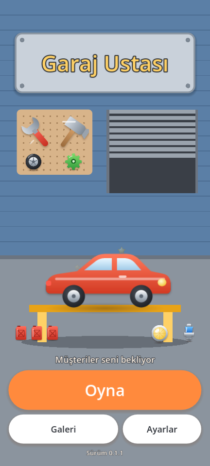
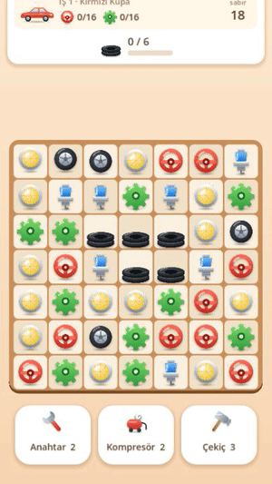
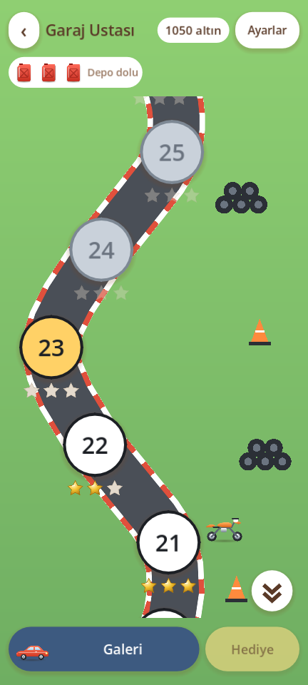
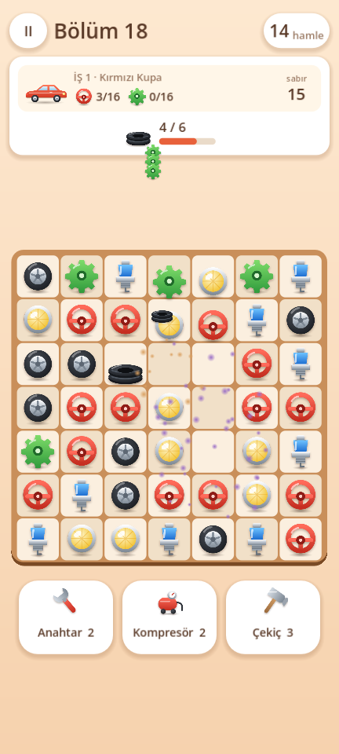
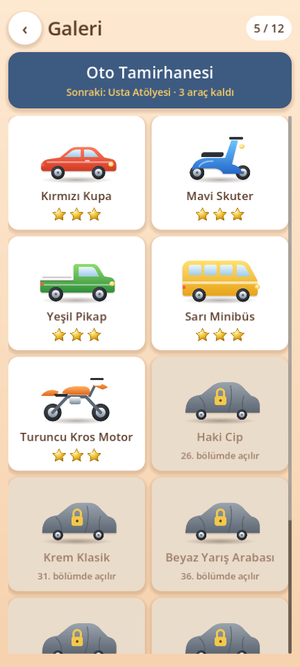

# Garaj Ustası

Müşterilerin araçlarını tamir edip galerini doldurduğun, **60 bölümlük** Türkçe bir match 3 oyunu.
Reklam yok, oyun içi satın alma yok, internet izni yok.

  
  

## Oyun

- **İş emri ve sabır.** Müşteriler aracını getirir; parçaları topladıkça tamir ilerler. Her takas, teslim edilmemiş müşterilerin sabrını bir azaltır. Sabrı biten müşteri aracını alıp gider ve bölüm kaybedilir.
- **Teslim etme.** İş emri tamamlanınca tamir edilen araç tahtaya düşer. Aracı aşağı indirmen gerekir; daha fazla inemeyince müşteriye teslim edilir.
- **60 bölüm.** İleri bölümlerde aynı anda birden çok müşteri bekler.
- **Parçalar.** Direksiyon, dişli, far, buji ve lastik.
- **Özel taşlar.** 4'lü eşleşme satır/sütun temizler, L ve T bomba yapar, 2x2 kare uçan taş çıkarır, 5'li eşleşme renk bombası verir.
- **Engeller.** Lastik yığını, paslı varil, zincirli parça, yağ lekesi, garajdaki fare ve konveyör bant.
- **Galeri.** 12 araç vardır, her 5 bölümde biri açılır: kupa, skuter, pikap, minibüs, kros motor, cip, klasik, yarış arabası, çekici, hızlı motor, itfaiye aracı ve karavan. Hiçbiri gerçek bir marka ya da model değildir. Galeri doldukça garajın rütbesi büyür: Mahalle Garajı, Oto Tamirhanesi, Usta Atölyesi, Şampiyon Galeri.
- **Can sistemi.** 3 yakıt bidonu vardır; kaybedilen deneme bir bidonu boşaltır, bidonlar zamanla dolar.
- **Güçlendiriciler.** Anahtar, kompresör ve çekiç; altınla alınır.
- **Ayarlar.** Düşük/orta/yüksek grafik profili, "animasyonları azalt", pil tasarrufu ve titreşim.

## Ekran görüntüleri

| Harita | Oynanış | Galeri |
|---|---|---|
|  |  |  |

## İndir ve oyna

1. [Releases](../../releases) sayfasından en son `garaj-ustasi-*.apk` dosyasını telefonuna indir.
2. Dosyayı aç. Android "bilinmeyen kaynak" uyarısı verirse bu kaynağa izin ver.
3. Android 7.0 ve üstü gerekir. Uygulama test sürümüdür, hata ayıklama anahtarıyla imzalanmıştır; Play Store sürümü değildir.

Oyun hiçbir veri toplamaz ve internete bağlanmaz. İlerlemen yalnızca telefonunda, uygulamanın kendi klasöründeki `save.json` dosyasında tutulur.

## Lisans

Kod **MIT** lisanslıdır ([LICENSE](LICENSE)). Oyundaki her çizim, ses ve metin bu proje için üretildi; hiçbiri hazır varlık paketinden alınmadı, gerçek araba markası, logosu ya da model adı kullanılmadı. Ayrıntılı döküm için [CREDITS.md](CREDITS.md).

Kaynaktan derlemek, çizimleri ya da bölümleri yeniden üretmek için: [docs/gelistirme.md](docs/gelistirme.md)

---

<b>English:</b> Garaj Ustası ("Garage Master") is a Turkish match 3 game with 60 levels: customers bring vehicles in for repair and lose patience with every swap, and a finished vehicle must be dropped down the board to be delivered, joining your gallery. No real car brands or model names are used. No ads, no in-app purchases, no internet permission. Get the APK from <a href="../../releases">Releases</a>. Code is MIT licensed; build notes are in <a href="docs/gelistirme.md">docs/gelistirme.md</a>.
